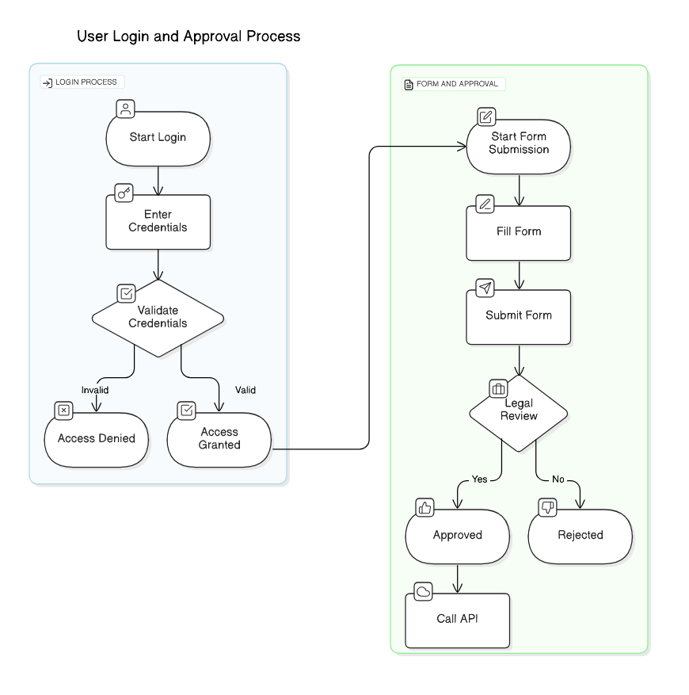

# bin
- scrips utilies para el workflow diario
    - deberian ser para cualquier user root no-root
# Tareas
- [hacer orden en subdir id:7](#IDEA:) 
- [logger de actividad id:12](#FIX:) 
# History
## 2018-11-12
- Agregado de kick
## 2018-08-17
- Volviendo a tomar temas
- Configurado den Imdome
## 2018-01-16
- Volviendo a tomar temas
## 2018-01-10
- [https://github.com/paulrm/bin/issues/36](https://github.com/paulrm/bin/issues/36) 
Paul
[pmessina@invap.com.ar](mailto:pmessina@invap.com.ar) 
- [https://github.com/paulrm/bin/issues/37](https://github.com/paulrm/bin/issues/37) 
Paul Messina
[paul.messina@gmail.com](mailto:paul.messina@gmail.com) 
## 2017-11-13
- puliendo el backup taiga
- :Idea: un delete que borre x dias atras, pero deje -x semanales x mensuales
- Renombrado backup-taiga
## 2017-11-10
- arreglando backups
## 2017-07-04
- Agregado de h y cmds, levemente adaptados

<!-- eraser-additional-content -->
## Diagrams
<!-- eraser-additional-files -->

<!-- end-eraser-additional-files -->
<!-- end-eraser-additional-content -->
<!--- Eraser file: https://app.eraser.io/workspace/7AnxiDsv5hiT5dBGxkmV --->